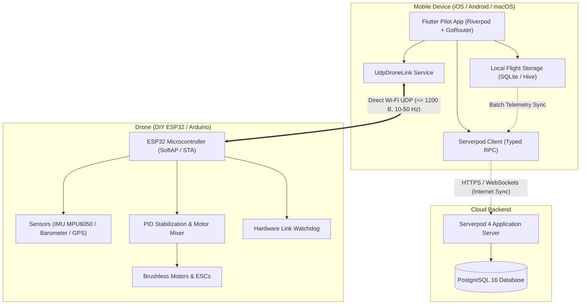
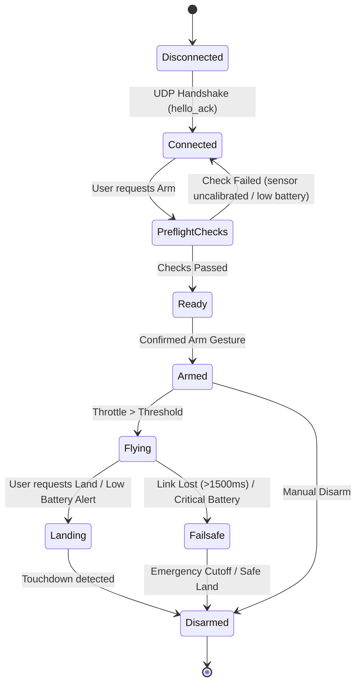

# Drone Control Pilot — Master Project & Architecture Guide
**Cross-Platform Ground Control Station (GCS) & Autonomous Drone Platform**  
*Technology Stack: Flutter (Dart) · Riverpod · GoRouter · Serverpod 4 · PostgreSQL · Wi-Fi UDP · ESP32 / Arduino*

---

## Table of Contents
1. [Executive Summary & Core Philosophy](#1-executive-summary--core-philosophy)
2. [High-Level System Architecture](#2-high-level-system-architecture)
3. [Communication Protocol & Network Topology](#3-communication-protocol--network-topology)
4. [Hardware & ESP32 Firmware Architecture](#4-hardware--esp32-firmware-architecture)
5. [Flutter Ground Control Station (GCS) Design](#5-flutter-ground-control-station-gcs-design)
6. [Serverpod Backend & PostgreSQL Database Architecture](#6-serverpod-backend--postgresql-database-architecture)
7. [Cockpit & Mission Planner UI/UX](#7-cockpit--mission-planner-uiux)
8. [Safety, Reliability & Failsafe Engineering](#8-safety-reliability--failsafe-engineering)
9. [Development Environment & macOS Setup Guide](#9-development-environment--macos-setup-guide)
10. [File-by-File Starter Implementation](#10-file-by-file-starter-implementation)
11. [Verification, Testing & Simulation Guide](#11-verification-testing--simulation-guide)
12. [Mobile Platform Configuration (iOS & Android)](#12-mobile-platform-configuration-ios--android)
13. [Phased Implementation Roadmap & Milestones](#13-phased-implementation-roadmap--milestones)

---

## 1. Executive Summary & Core Philosophy

**Drone Control Pilot** is a production-grade, local-first drone ground control station and fleet management platform. It pairs a high-performance **Flutter** mobile client with a dedicated **Serverpod** cloud backend and an **ESP32**-based DIY drone flight controller over local **Wi-Fi UDP**.

### Non-Negotiable Engineering Principles

1. **Decoupled Flight Loop:**  
   The drone flight-control loop lives exclusively on the onboard microcontroller (ESP32/Arduino). Under no circumstances is the cloud (Serverpod) or the mobile app in the high-frequency motor stabilization loop.
2. **Local-First & Offline Autonomy:**  
   The mobile application connects directly to the drone via Wi-Fi UDP. Full flight capability, telemetry display, manual controls, and failsafe execution operate 100% offline without requiring internet access or Serverpod availability.
3. **Firmware-Enforced Failsafes:**  
   The drone must remain capable of stabilizing itself, initiating controlled descent, or disarming safely if the Wi-Fi connection drops, without waiting for app instructions.
4. **Asynchronous Cloud Synchronization:**  
   High-frequency flight telemetry (10–50 Hz) is buffered locally on the device (SQLite/Hive). Summarized flight metrics, sessions, waypoints, and incident logs are batched and synced to Serverpod when internet connectivity is restored.

### Key Architectural Decisions

- **Flutter:** Cross-platform Android and iOS pilot interface.
- **Riverpod:** Reactive state management and dependency injection.
- **GoRouter:** Declarative application navigation with offline route guards.
- **MVC:** Main code organization pattern (Model-View-Controller) within each feature module.
- **UDP + Protocol Adapter:** Direct, low-latency local communication with the drone flight controller.
- **Serverpod + PostgreSQL:** Optional cloud functionality (fleet registry, mission sync, flight session history), never required for basic flight control.
- **Simulated Drone:** Develop, validate, and stress-test the complete mobile application without physical hardware first.

---

## 2. High-Level System Architecture

The system is bifurcated into two independent communication pipelines:
- **Real-Time Flight Pipeline (Local):** Flutter Pilot App ↔ Direct Wi-Fi UDP ↔ ESP32 Flight Controller.
- **Fleet & Management Pipeline (Cloud):** Flutter Pilot App ↔ Secure WebSockets/HTTPS ↔ Serverpod Backend ↔ PostgreSQL Database.



---

## 3. Communication Protocol & Network Topology

### 3.1 Network Configuration
- **Access Point Mode (SoftAP - Recommended for Field Operation):**  
  The ESP32 broadcasts its own Wi-Fi SSID (e.g., `DRONE-PILOT-01`, WPA2). The smartphone connects directly to the drone's Wi-Fi network.  
  *Default Drone IP:* `192.168.4.1` | *Default Port:* `8765`  
  *Smartphone Client IP:* `192.168.4.2` | *Listen Port:* `8766`
- **Station Mode (WLAN - Lab/Development):**  
  Both the drone and the developer workstation/phone connect to the same Wi-Fi router.

> [!IMPORTANT]
> When connected to the drone's SoftAP, the smartphone OS will indicate *"Wi-Fi has no internet connection"*. The Flutter app networking layer must bind directly to the local network interface and ignore OS captive-portal warnings.

### 3.2 Protocol Specification: UDP Protocol v1.0
The initial development phase utilizes UTF-8 JSON datagrams for maximum inspectability and rapid debugging, transitioning to compact binary serialization (e.g., Protocol Buffers or CRTP framing) for production.

Full specification is maintained in [`docs/udp-protocol-v1.md`](docs/udp-protocol-v1.md).

| Message Type | Direction | Rate | Description |
|---|---|---|---|
| `hello` | App → Drone | On connect | Handshake request with client ID and protocol version. |
| `hello_ack` | Drone → App | Once | Handshake response with firmware version & capabilities. |
| `ping` / `pong` | Both | 1–2 Hz | Heartbeat verification and round-trip latency tracking. |
| `telemetry` | Drone → App | 5–20 Hz | Attitude (roll/pitch/yaw), altitude, speed, battery, GPS, link quality. |
| `control_setpoint` | App → Drone | 20–50 Hz | Normalized manual inputs: roll, pitch, yaw [-1.0, 1.0], thrust [0.0, 1.0]. |
| `arm` / `disarm` | App → Drone | On demand | Validated state transitions with safety interlocks. |
| `land` | App → Drone | On demand | Automated controlled descent and motor shutdown. |
| `emergency_stop` | App → Drone | Immediate | Instant motor cutoff in catastrophic loss-of-control conditions. |

---

## 4. Hardware & ESP32 Firmware Architecture

### 4.1 Hardware Topologies
1. **Option A (Integrated ESP32):**  
   A dual-core ESP32 handles Wi-Fi UDP networking on Core 0 and the real-time sensor fusion / PID motor control loop on Core 1 (FreeRTOS).
2. **Option B (Split Architecture):**  
   The ESP32 acts as a high-speed telemetry bridge over Wi-Fi, forwarding validated commands via UART (DMA) to a dedicated flight controller (Arduino Mega, STM32, or Betaflight/INAV board).
3. **Option C (ESP-Drone / Crazyflie Port):**  
   Espressif’s open-source `ESP-Drone` firmware using CRTP packets over UDP.

### 4.2 Firmware Module Structure (PlatformIO)
```text
drone_firmware/
├── platformio.ini
├── include/
│   └── config.h
└── src/
    ├── main.cpp
    ├── communication/
    │   ├── wifi_manager.cpp       # SoftAP & DHCP configuration
    │   ├── udp_server.cpp         # Non-blocking UDP packet listener
    │   ├── protocol_parser.cpp    # JSON/binary validation & unpacking
    │   └── command_validator.cpp  # Range checking & rate limiting
    ├── flight/
    │   ├── flight_state.cpp       # Finite State Machine
    │   ├── attitude_controller.cpp# IMU sensor fusion (Madgwick/Mahony)
    │   ├── pid_controller.cpp     # Angle & rate PID stabilization
    │   └── motor_mixer.cpp        # Quadcopter X-configuration mixing
    ├── safety/
    │   ├── link_watchdog.cpp      # 1500ms setpoint timeout failsafe
    │   ├── battery_failsafe.cpp   # Low voltage alarm & auto-land
    │   └── arming_checks.cpp      # Gyro calibration & flat surface check
    └── sensors/
        ├── imu.cpp                # MPU6050 / ICM-42688 (I2C/SPI)
        ├── barometer.cpp          # BMP280 / MS5611 altitude estimation
        └── battery_monitor.cpp    # ADC voltage divider & current sensor
```

---

## 5. Flutter Ground Control Station (GCS) Design

### 5.1 Project Layout (Feature-First Architecture)
```text
Drone/
├── app/                            # Flutter mobile app (Android, iOS, macOS, Web)
│   ├── lib/
│   │   ├── main.dart
│   │   ├── app/
│   │   │   ├── app.dart            # MaterialApp.router, dark theme
│   │   │   └── router.dart         # GoRouter definition with offline route guards
│   │   ├── core/
│   │   │   ├── constants/          # AppColors, telemetry constants
│   │   │   └── services/           # Serverpod client provider
│   │   ├── features/
│   │   │   ├── dashboard/          # Primary cockpit dashboard & instruments
│   │   │   ├── drone_connection/   # UDP socket service & watchdog timer
│   │   │   ├── flight_control/     # Mode 2 virtual sticks, arming switch, auto-land
│   │   │   ├── telemetry/          # DroneTelemetry model & Riverpod providers
│   │   │   └── fleet/              # Serverpod cloud fleet registry & health status
│   │   └── shared/
│   │       └── widgets/            # Metric cards & gauges
│   └── test/
│
├── server/                         # Serverpod 4 Cloud Backend
│   ├── bin/main.dart               # Server entry point
│   ├── config/                     # generator.yaml, passwords, environments
│   └── lib/src/
│       ├── system/                 # System healthcheck endpoint & models
│       ├── drone/                  # Drone registry endpoint & models
│       └── flight/                 # Flight session history endpoint & models
│
├── client/                         # Generated typed Dart client library
├── tools/                          # Standalone Python UDP drone simulator
└── docs/                           # Protocol specification documentation
```

### 5.2 Flutter Technology Stack
- **State Management:** `flutter_riverpod` (v2.6+)
- **Navigation:** `go_router` (v14+)
- **Networking:** Native `dart:io` `RawDatagramSocket`
- **Charts & Graphs:** `fl_chart`
- **Maps:** `google_maps_flutter` or `flutter_map`
- **Local Persistence:** `hive_ce` or `sqflite` (for buffered high-frequency logs)

---

## 6. Serverpod Backend & PostgreSQL Database Architecture

### 6.1 Database Schema (YAML Definitions)
Serverpod manages the PostgreSQL schema through declarative `.spy.yaml` models:

```yaml
# drone_control_pilot_server/lib/src/models/drone_device.spy.yaml
class: DroneDevice
table: drone_device
fields:
  ownerId: int, relation(parent=serverpod_auth_user)
  deviceId: String, unique
  name: String
  model: String
  firmwareVersion: String
  capabilities: List<String>
  createdAt: DateTime
```

```yaml
# drone_control_pilot_server/lib/src/models/flight_session.spy.yaml
class: FlightSession
table: flight_session
fields:
  ownerId: int
  droneId: String
  startTime: DateTime
  endTime: DateTime?
  maxAltitudeMeters: double
  maxSpeedMps: double
  durationSeconds: int?
  status: String # completed, aborted, crash
  notes: String?
```

```yaml
# drone_control_pilot_server/lib/src/models/mission_waypoint.spy.yaml
class: MissionWaypoint
table: mission_waypoint
fields:
  missionId: int
  sequenceIndex: int
  latitude: double
  longitude: double
  altitudeMeters: double
  speedMps: double
  action: String # hover, photograph, land
```

### 6.2 Endpoint Organization
```text
drone_control_pilot_server/lib/src/endpoints/
├── system_endpoint.dart          # Healthcheck, cluster status
├── drone_endpoint.dart           # Drone registration, capabilities
├── mission_endpoint.dart         # Cloud mission CRUD & waypoint storage
└── flight_session_endpoint.dart  # Batch upload of post-flight telemetry
```

---

## 7. Cockpit & Mission Planner UI/UX

The user interface adopts an aeronautical dark tactical aesthetic:
- **Palette:** Jet Black (`#0B1120`), Cockpit Slate (`#172033`), Avionics Blue (`#3B82F6`), Alert Amber (`#F59E0B`), Emergency Red (`#EF4444`), Telemetry Green (`#10B981`).
- **Primary Flight Display (PFD):**
  - Artificial Horizon with dynamic pitch ladder and roll indicator.
  - Altitude ribbon (meters) & Vertical Speed Indicator (VSI).
  - Heading compass tape (0°–360°).
  - Battery Gauge: Voltage, percentage, estimated remaining flight minutes.
- **Controls Layout (Standard Mode 2):**
  - Left Joystick: Throttle (vertical) & Yaw/Rudder (horizontal).
  - Right Joystick: Pitch/Elevator (vertical) & Roll/Aileron (horizontal).
  - Dedicated **Arming Swipe Slider** with two-stage confirmation.
  - Prominent, persistent **Auto-Land** and **Emergency Stop** triggers.

---

## 8. Safety, Reliability & Failsafe Engineering



### Safety Interlocks:
1. **Propellers-Off Bench Testing:** Never test motor commands or PID loops with propellers installed indoors.
2. **Firmware Link Watchdog:** If no `control_setpoint` or `ping` is received for **1500 ms**, the drone firmware enters auto-stabilize descent.
3. **App Telemetry Watchdog:** If no telemetry packet is received for **3000 ms**, the Flutter UI alerts the user with audio and visual alarms.
4. **Arming Pre-requisites:**
   - Drone must be static and level (< 5° tilt).
   - Gyroscope drift calibration complete.
   - Battery voltage above minimum threshold (> 3.5V per cell).
   - Throttle stick must be verified at zero.

---

## 9. Development Environment & macOS Setup Guide

### 9.1 Verify Toolchain
Run these verification commands in macOS Terminal:
```bash
flutter --version
dart --version
flutter doctor -v
python3 --version
docker --version
```

*Current Machine Status:*
- **Flutter:** 3.38.5 (Channel Stable)
- **Dart:** 3.10.4
- **Python:** 3.9.6

> [!NOTE]
> Serverpod 4 requires Flutter 3.44.4+ for its newest features. If you are on Flutter 3.38.5, you can either upgrade Flutter (`flutter upgrade`) or use Serverpod 3.x / Serverpod 2.x CLI.

### 9.2 Install Serverpod CLI
```bash
# Deactivate any conflicting legacy version
dart pub global deactivate serverpod_cli 2>/dev/null || true

# Install the latest compatible Serverpod CLI
dart pub global activate serverpod_cli

# Verify installation
serverpod version
```

### 9.3 Scaffolding the Project
```bash
mkdir -p ~/Documents/Development/App/Drone
cd ~/Documents/Development/App/Drone

# Create the full Serverpod + Flutter workspace
serverpod create drone_control_pilot
cd drone_control_pilot
```

### 9.4 Add Core Flutter Dependencies
```bash
cd drone_control_pilot_flutter

flutter pub add flutter_riverpod go_router
flutter pub add fl_chart google_maps_flutter
flutter pub add shared_preferences permission_handler
```

### 9.5 Start Serverpod & PostgreSQL
```bash
cd ~/Documents/Development/App/Drone/drone_control_pilot
serverpod start
```

---

## 10. File-by-File Starter Implementation

Below are the complete, drop-in starter files for Phase 1.

### 10.1 File 1 — `tools/drone_simulator.py`
Located at [`tools/drone_simulator.py`](tools/drone_simulator.py).  
A standalone Python asyncio UDP server simulating real-time telemetry, handshake negotiation, and simulated flight commands.

### 10.2 File 2 — `drone_control_pilot_flutter/lib/features/drone_connection/services/udp_drone_link.dart`
```dart
import 'dart:async';
import 'dart:convert';
import 'dart:io';

class UdpDroneLink {
  UdpDroneLink({
    required this.host,
    this.port = 8765,
    this.localPort = 8766,
  });

  final String host;
  final int port;
  final int localPort;

  RawDatagramSocket? _socket;
  StreamSubscription<RawSocketEvent>? _subscription;
  final _messages = StreamController<Map<String, dynamic>>.broadcast();

  int _sequence = 0;
  bool _connected = false;

  Stream<Map<String, dynamic>> get messages => _messages.stream;
  bool get isConnected => _connected;

  Future<void> connect() async {
    if (_socket != null) return;

    final socket = await RawDatagramSocket.bind(
      InternetAddress.anyIPv4,
      localPort,
    );

    _socket = socket;

    _subscription = socket.listen((event) {
      if (event != RawSocketEvent.read) return;

      Datagram? datagram;
      while ((datagram = socket.receive()) != null) {
        try {
          final decoded = jsonDecode(utf8.decode(datagram!.data));
          if (decoded is! Map<String, dynamic>) continue;
          if (decoded['v'] != 1) continue;

          if (decoded['type'] == 'hello_ack') {
            _connected = true;
          }

          _messages.add(decoded);
        } on FormatException {
          // Discard malformed packets silently
        }
      }
    });

    // Send initial handshake
    _send({
      'v': 1,
      'type': 'hello',
      'client_id': 'pilot-dev-001',
    });
  }

  void _send(Map<String, dynamic> message) {
    final socket = _socket;
    if (socket == null) {
      throw StateError('UDP socket is not initialized.');
    }

    final bytes = utf8.encode(jsonEncode({
      ...message,
      'seq': ++_sequence,
    }));

    if (bytes.length > 1200) {
      throw ArgumentError('UDP message exceeds 1200 byte MTU limit.');
    }

    socket.send(bytes, InternetAddress(host), port);
  }

  void ping() => _send({'v': 1, 'type': 'ping'});
  void armSimulation() => _send({'v': 1, 'type': 'arm_simulated'});
  void disarmSimulation() => _send({'v': 1, 'type': 'disarm_simulated'});

  Future<void> disconnect() async {
    await _subscription?.cancel();
    _subscription = null;
    _socket?.close();
    _socket = null;
    _connected = false;
  }

  Future<void> dispose() async {
    await disconnect();
    await _messages.close();
  }
}
```

### 10.3 File 3 — `drone_control_pilot_flutter/lib/features/telemetry/providers/drone_providers.dart`
```dart
import 'dart:async';
import 'package:flutter_riverpod/flutter_riverpod.dart';
import '../../drone_connection/services/udp_drone_link.dart';

final droneHostProvider = StateProvider<String>((ref) => '127.0.0.1');

final droneLinkProvider = Provider<UdpDroneLink>((ref) {
  final host = ref.watch(droneHostProvider);
  final link = UdpDroneLink(host: host);

  ref.onDispose(() {
    unawaited(link.dispose());
  });

  return link;
});

final droneTelemetryProvider = StreamProvider<Map<String, dynamic>>((ref) async* {
  final link = ref.watch(droneLinkProvider);
  await link.connect();
  yield* link.messages;
});
```

### 10.4 File 4 — `drone_control_pilot_flutter/lib/features/dashboard/views/dashboard_screen.dart`
```dart
import 'package:flutter/material.dart';
import 'package:flutter_riverpod/flutter_riverpod.dart';
import '../../telemetry/providers/drone_providers.dart';

class DashboardScreen extends ConsumerWidget {
  const DashboardScreen({super.key});

  @override
  Widget build(BuildContext context, WidgetRef ref) {
    final telemetry = ref.watch(droneTelemetryProvider);

    return Scaffold(
      appBar: AppBar(
        title: const Text('Drone Control Pilot'),
        actions: [
          IconButton(
            tooltip: 'Reconnect Link',
            onPressed: () => ref.invalidate(droneTelemetryProvider),
            icon: const Icon(Icons.refresh),
          ),
        ],
      ),
      body: telemetry.when(
        loading: () => const Center(
          child: Column(
            mainAxisSize: MainAxisSize.min,
            children: [
              CircularProgressIndicator(),
              SizedBox(height: 16),
              Text('Connecting to drone Wi-Fi link...'),
            ],
          ),
        ),
        error: (error, _) => Center(
          child: Text('Link Error: $error', style: const TextStyle(color: Colors.redAccent)),
        ),
        data: (data) {
          final isSim = data['mode'] == 'SIMULATION' || data['device_id'] == 'SIM-001';
          return ListView(
            padding: const EdgeInsets.all(16),
            children: [
              Card(
                color: isSim ? const Color(0xFF1E293B) : const Color(0xFF172554),
                child: ListTile(
                  leading: Icon(isSim ? Icons.science : Icons.flight, color: Colors.blueAccent),
                  title: Text(isSim ? 'SIMULATION MODE' : 'DRONE LINK ACTIVE'),
                  subtitle: Text('Device ID: ${data['device_id'] ?? 'Unknown'}'),
                  trailing: Chip(
                    label: Text(data['armed'] == true ? 'ARMED' : 'DISARMED'),
                    backgroundColor: data['armed'] == true ? Colors.red.shade900 : Colors.green.shade900,
                  ),
                ),
              ),
              const SizedBox(height: 12),
              _MetricCard(
                label: 'Battery Reserve',
                value: '${data['battery_percent'] ?? '--'}%',
                icon: Icons.battery_charging_full,
                color: Colors.greenAccent,
              ),
              _MetricCard(
                label: 'Altitude',
                value: '${data['altitude_m'] ?? '--'} m',
                icon: Icons.height,
                color: Colors.lightBlueAccent,
              ),
              _MetricCard(
                label: 'Airspeed',
                value: '${data['speed_mps'] ?? '--'} m/s',
                icon: Icons.speed,
                color: Colors.orangeAccent,
              ),
              _MetricCard(
                label: 'Heading',
                value: '${data['yaw_deg'] ?? '--'}°',
                icon: Icons.explore,
                color: Colors.purpleAccent,
              ),
              _MetricCard(
                label: 'GPS Fix',
                value: data['gps_fix'] == true ? '3D Fix Locked' : 'No Fix',
                icon: Icons.gps_fixed,
                color: data['gps_fix'] == true ? Colors.green : Colors.grey,
              ),
            ],
          );
        },
      ),
    );
  }
}

class _MetricCard extends StatelessWidget {
  const _MetricCard({
    required this.label,
    required this.value,
    required this.icon,
    required this.color,
  });

  final String label;
  final String value;
  final IconData icon;
  final Color color;

  @override
  Widget build(BuildContext context) {
    return Card(
      child: ListTile(
        leading: Icon(icon, color: color),
        title: Text(label),
        trailing: Text(value, style: Theme.of(context).textTheme.titleLarge),
      ),
    );
  }
}
```

### 10.5 File 5 — `drone_control_pilot_flutter/lib/app/router.dart`
```dart
import 'package:go_router/go_router.dart';
import '../features/dashboard/views/dashboard_screen.dart';

final appRouter = GoRouter(
  initialLocation: '/',
  routes: [
    GoRoute(
      path: '/',
      name: 'dashboard',
      builder: (context, state) => const DashboardScreen(),
    ),
  ],
);
```

### 10.6 File 6 — `drone_control_pilot_flutter/lib/app/app.dart`
```dart
import 'package:flutter/material.dart';
import 'router.dart';

class DronePilotApp extends StatelessWidget {
  const DronePilotApp({super.key});

  @override
  Widget build(BuildContext context) {
    return MaterialApp.router(
      title: 'Drone Control Pilot',
      debugShowCheckedModeBanner: false,
      routerConfig: appRouter,
      theme: ThemeData(
        useMaterial3: true,
        brightness: Brightness.dark,
        scaffoldBackgroundColor: const Color(0xFF0B1120),
        colorScheme: ColorScheme.fromSeed(
          seedColor: const Color(0xFF3B82F6),
          brightness: Brightness.dark,
        ),
        cardTheme: const CardThemeData(
          color: Color(0xFF172033),
          elevation: 2,
        ),
      ),
    );
  }
}
```

### 10.7 File 7 — `drone_control_pilot_flutter/lib/main.dart`
```dart
import 'package:flutter/material.dart';
import 'package:flutter_riverpod/flutter_riverpod.dart';
import 'app/app.dart';

void main() {
  WidgetsFlutterBinding.ensureInitialized();
  runApp(
    const ProviderScope(
      child: DronePilotApp(),
    ),
  );
}
```

### 10.8 File 8 — `drone_control_pilot_server/lib/src/endpoints/system_endpoint.dart`
```dart
import 'package:serverpod/serverpod.dart';

class SystemEndpoint extends Endpoint {
  Future<Map<String, String>> status(Session session) async {
    return {
      'service': 'Drone Control Pilot API',
      'status': 'healthy',
      'version': '1.0.0',
      'mode': 'development',
    };
  }
}
```

---

## 11. Verification, Testing & Simulation Guide

### Test A: Run the Drone Simulator
In Terminal 1 (workspace root):
```bash
python3 tools/drone_simulator.py
```
*Expected Output:*
```text
[SIMULATOR] Drone simulator running on 0.0.0.0:8765
[SIMULATOR] Waiting for client connections (e.g. Flutter app)...
```

### Test B: Run Flutter on macOS Desktop
In Terminal 2:
```bash
cd drone_control_pilot/drone_control_pilot_flutter
flutter pub get
flutter run -d macos
```
*Verification Check:* The app will open, establish the handshake, and display live updating telemetry (battery drain, altitude, yaw angle).

### Test C: Run on Android Emulator
Update `droneHostProvider` in `drone_providers.dart` to use the host loopback IP:
```dart
final droneHostProvider = StateProvider<String>((ref) => '10.0.2.2');
```
Launch on Android:
```bash
flutter run -d android
```

### Test D: Failsafe Invariant Testing
1. **Link Loss Test:** Stop the simulator with `Ctrl+C`. Verify that the Flutter UI reflects link disconnection within 3 seconds.
2. **Packet Fuzzing:** Send an invalid JSON packet via `nc -u 127.0.0.1 8765`. Confirm the simulator rejects the packet without crashing.
3. **Command Expiry:** Confirm setpoints are dropped if older than 500 ms.

---

## 12. Mobile Platform Configuration (iOS & Android)

### iOS Configuration (`ios/Runner/Info.plist`)
Apple enforces strict privacy restrictions for local network discovery and UDP unicast/multicast:
```xml
<key>NSLocalNetworkUsageDescription</key>
<string>Drone Control Pilot requires local network access to communicate directly with your drone over Wi-Fi.</string>
<key>NSBonjourServices</key>
<array>
    <string>_drone-udp._udp</string>
</array>
```

### Android Configuration (`android/app/src/main/AndroidManifest.xml`)
```xml
<!-- Basic network access -->
<uses-permission android:name="android.permission.INTERNET" />
<uses-permission android:name="android.permission.ACCESS_NETWORK_STATE" />
<uses-permission android:name="android.permission.ACCESS_WIFI_STATE" />
<uses-permission android:name="android.permission.CHANGE_WIFI_MULTICAST_STATE" />

<!-- Local network permissions for Android 17 (API 37+) -->
<uses-permission android:name="android.permission.ACCESS_LOCAL_NETWORK" />
```

---

## 13. Phased Implementation Roadmap & Milestones

| Phase | Milestone | Deliverables | Exit Criteria |
|---|---|---|---|
| **01** | **Foundation** | Serverpod workspace, UDP simulator, starter Flutter telemetry dashboard. | Simulator and Flutter app communicate over UDP with live gauge updates. |
| **02** | **Transport Hardening** | Bi-directional heartbeats, sequence validation, 3s link-loss watchdog, device pairing. | Failsafe triggers reliably upon connection cut with 0 unhandled exceptions. |
| **03** | **Cockpit & Flight Controls** | Virtual joysticks (Mode 2), arming slider, emergency stop button, mode selection. | All flight controls validated against firmware state machine; motors tested off. |
| **04** | **Cloud & Fleet Storage** | Serverpod models, PostgreSQL migrations, local flight buffering, batch session upload. | User accounts can securely register drones and view historical flight paths. |
| **05** | **Navigation & Missions** | Waypoint map editor, altitude profiler, mission upload & validation protocol. | Waypoint missions upload and pass geofence constraints. |
| **06** | **Live Video & Release** | RTSP/MJPEG video overlay, flight analytics, production Android/iOS builds. | Complete end-to-end flight test conducted with documentation. |
